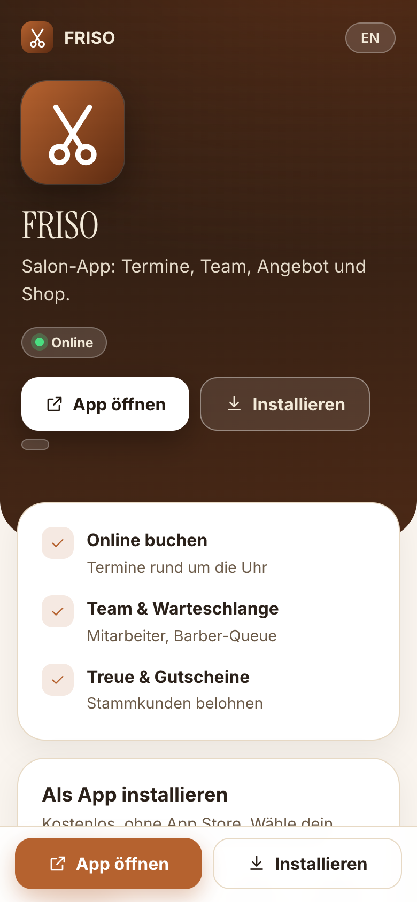
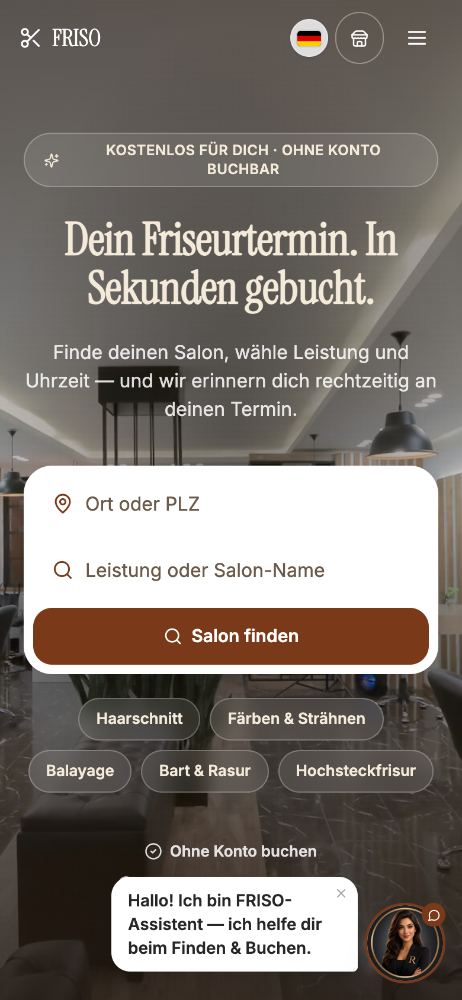
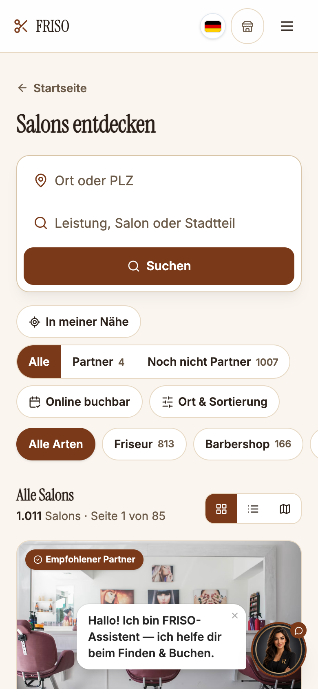
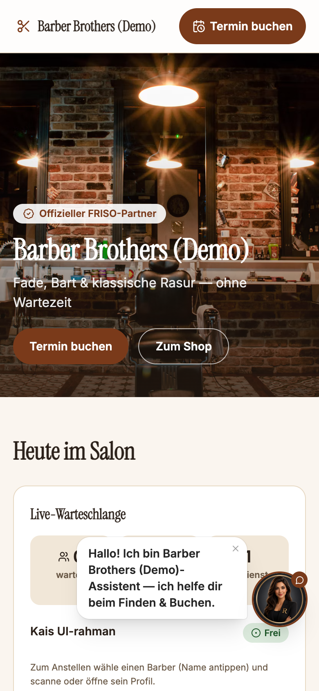
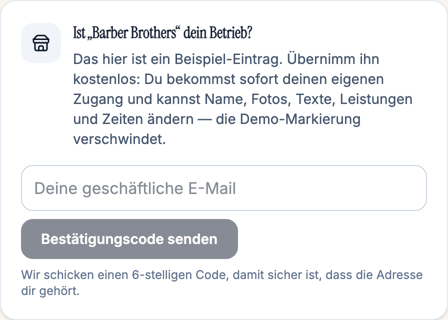
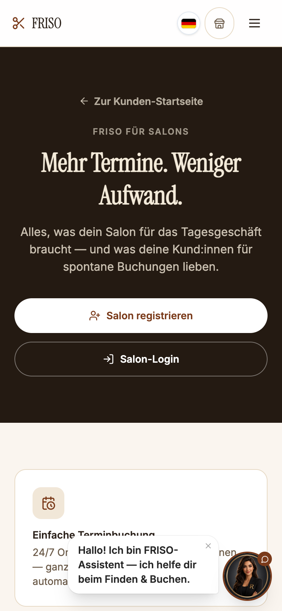
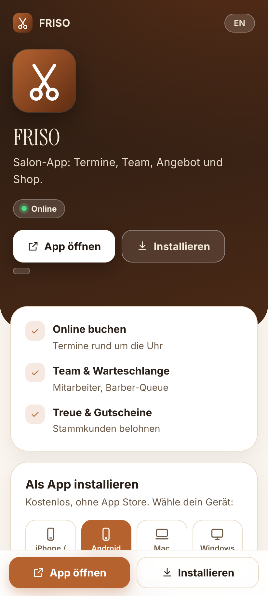
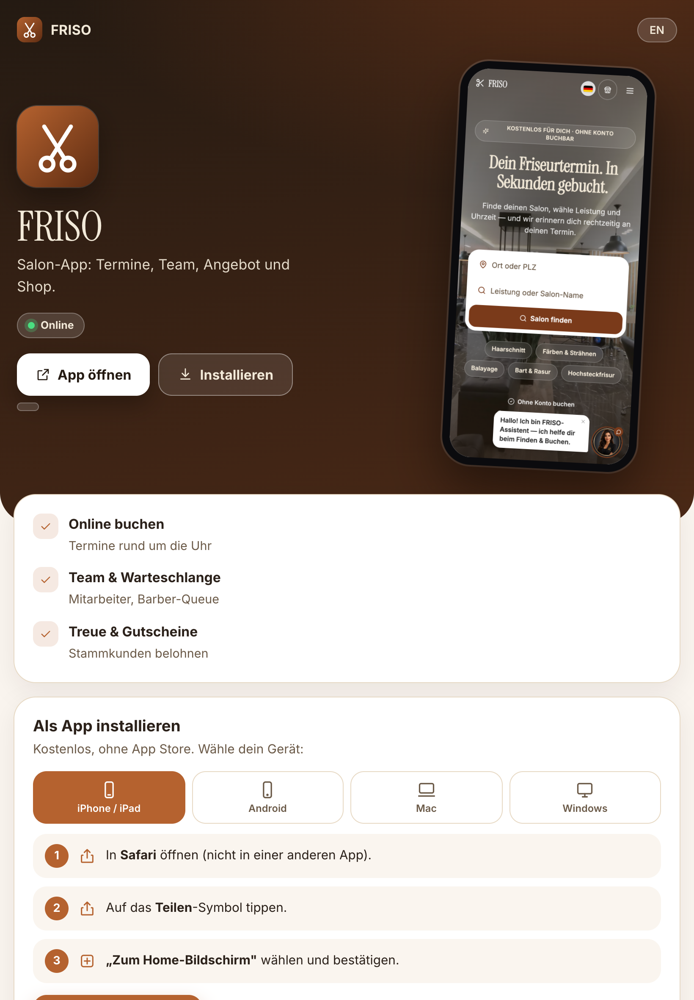
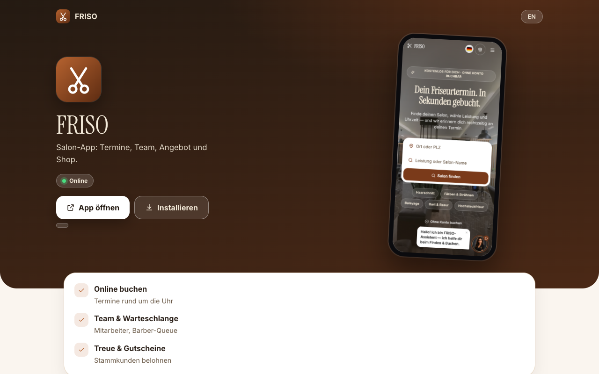

# FRISO

Salon app: appointments, team, offer and shop.

**Open and install: https://romal10.github.io/friso/**

 

## What you can do

- **Online booking** — Appointments around the clock
- **Team & queue** — Staff and barber queue
- **Loyalty & gift cards** — Reward regular customers

## How it works

1. Salons register or claim their listing.
2. Add services, prices, opening hours and team members.
3. Customers book on the salon page, with or without an account; you confirm and manage appointments in the app.
4. Use loyalty points, gift cards and the salon shop to bring customers back.

### For guests

1. Search for a salon, service or place — no account needed.
2. Pick a free slot and book; a reminder follows automatically.
3. Ask the chat assistant or let it help you book.
4. With an account: manage appointments, collect loyalty points and gift cards.

### For business owners

1. Find and claim your salon — or set it up by hand from scratch, both work.
2. Maintain services, prices, team, hours and photos yourself.
3. Appointments, queue and shop in the salon app.
4. The assistant answers customer questions and takes bookings.

### Is this your business? Claim it

Sample businesses (marked *Demo*) are there to try things out, next to thousands of listings from public directories.

1. Search for your salon in the list — or open one of the sample listings.
2. Tap “This is my business” and enter your email.
3. Enter the 6-digit code from the email.
4. You land in your own workspace at once: change name, photos, texts, services and hours — the demo marker disappears.

Prefer to set everything up by hand? That still works — register, create your business and enter your data.

Sample businesses to look at: Barber Brothers · Glow Beauty & Nails · Atelier Colour · Haarwerk Hamburg.

| Find a business | Open a sample listing | Claim it | For owners |
|---|---|---|---|
|  |  |  |  |

## Install the app — free, no app store

Open **https://romal10.github.io/friso/** on the device you want to install on and follow the steps for that device.

| Device | Steps |
|---|---|
| **iPhone / iPad** | 1. Open the page in **Safari**. 2. Tap the **Share** icon. 3. Choose **Add to Home Screen** and confirm. |
| **Android** | 1. Open the page in **Chrome**. 2. Tap **Install** (or menu ⋮ → **Install app**). |
| **Mac** | Chrome or Edge: click **Install**. Safari: **Share → Add to Dock**. |
| **Windows** | Edge or Chrome: click **Install**, or the install icon in the address bar. |

The app then opens in its own window or from your home screen, like any other app. You can also simply use it in the browser.

### What the page looks like on each device

| iPhone | Android | iPad | Mac / Windows |
|---|---|---|---|
|  |  |  |  |

*(Screenshots show this page at phone, tablet and desktop sizes.)*

## Accounts

- Joining a shared link needs no account where the host allows guests.
- Creating things (links, bookings, listings) and using other apps needs a free account — register inside the app.
- Registered users get every feature after signing in; without an account only this one app is available.

## Good to know

- The service runs privately and is reachable while the host computer is online. If the page shows **Offline**, try again later.
- This repository holds only the static launcher page. The application's code and data are not published here.
